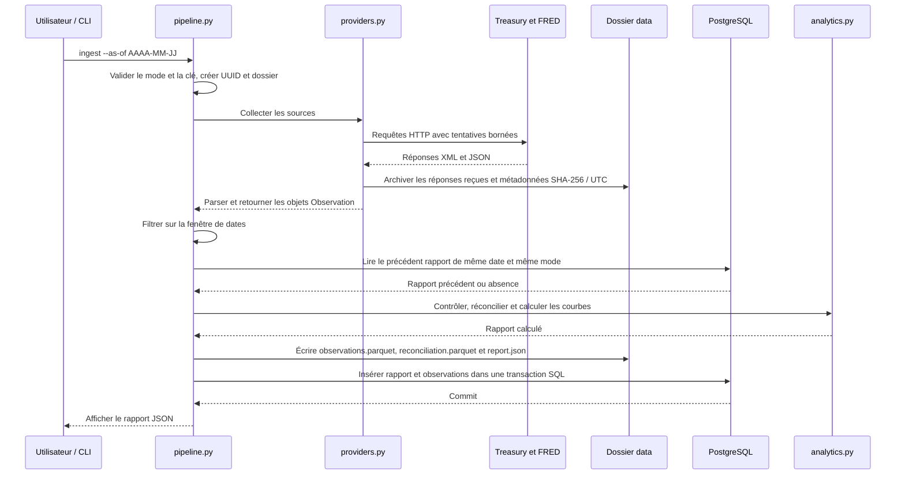
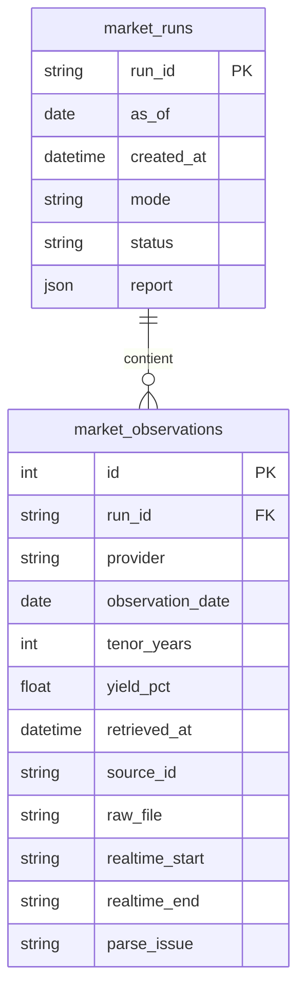

# Architecture de RateGuard

Ce document décrit le code actuel après le passage à PostgreSQL. Lis les schémas dans l’ordre : vue générale, ingestion, calculs, affichage, stockage puis déploiement.

**Le parcours principal :** lancer une collecte → archiver et contrôler les données → enregistrer un rapport dans PostgreSQL → consulter ce rapport dans l’interface.

Les blocs Mermaid sont visibles sous forme de schémas dans une visionneuse Markdown compatible. Les fichiers cités se trouvent dans `src/rateguard/`.

## 1. Vue générale : collecter, calculer, consulter

RateGuard compare les taux US de Treasury et FRED aux maturités **2, 5, 10 et 30 ans**. Deux actions sont distinctes : `rateguard ingest` collecte et calcule ; `rateguard serve` démarre le tableau de bord et l’API qui lisent les résultats enregistrés.

Les flèches représentent le parcours des données. **Ouvrir ou actualiser l’interface ne lance aucune collecte.** Sans historique réel, le mode Live ne peut pas afficher de statistiques.

```mermaid
flowchart LR
  treasury["U.S. Treasury &#58; flux XML"]
  fred["FRED &#58; API JSON"]
  cli["Commande ingest"]
  pipeline["Pipeline Python &#58; collecte et calculs"]
  files["Fichiers bruts, Parquet et JSON"]
  db["PostgreSQL &#58; observations et rapports"]
  api["FastAPI &#58; lecture des rapports"]
  ui["Navigateur &#58; tableau de bord"]
  cli -->|déclenche| pipeline
  treasury -->|taux par officiels| pipeline
  fred -->|séries DGS et clé FRED| pipeline
  pipeline -->|archive| files
  pipeline -->|enregistre| db
  db -->|rapports et historique| api
  api -->|réponses JSON| ui
%% portable-canonical-v2:eyJhY2Nlc3NpYmlsaXR5IjpudWxsLCJkYXRhIjp7ImRpcmVjdGlvbiI6IkxSIiwiZWRnZXMiOlt7ImZyb20iOiJjbGkiLCJsYWJlbCI6ImTDqWNsZW5jaGUiLCJ0byI6InBpcGVsaW5lIn0seyJmcm9tIjoidHJlYXN1cnkiLCJsYWJlbCI6InRhdXggcGFyIG9mZmljaWVscyIsInRvIjoicGlwZWxpbmUifSx7ImZyb20iOiJmcmVkIiwibGFiZWwiOiJzw6lyaWVzIERHUyBldCBjbMOpIEZSRUQiLCJ0byI6InBpcGVsaW5lIn0seyJmcm9tIjoicGlwZWxpbmUiLCJsYWJlbCI6ImFyY2hpdmUiLCJ0byI6ImZpbGVzIn0seyJmcm9tIjoicGlwZWxpbmUiLCJsYWJlbCI6ImVucmVnaXN0cmUiLCJ0byI6ImRiIn0seyJmcm9tIjoiZGIiLCJsYWJlbCI6InJhcHBvcnRzIGV0IGhpc3RvcmlxdWUiLCJ0byI6ImFwaSJ9LHsiZnJvbSI6ImFwaSIsImxhYmVsIjoicsOpcG9uc2VzIEpTT04iLCJ0byI6InVpIn1dLCJub2RlcyI6W3siaWQiOiJ0cmVhc3VyeSIsImxhYmVsIjoiVS5TLiBUcmVhc3VyeSA6IGZsdXggWE1MIn0seyJpZCI6ImZyZWQiLCJsYWJlbCI6IkZSRUQgOiBBUEkgSlNPTiJ9LHsiaWQiOiJjbGkiLCJsYWJlbCI6IkNvbW1hbmRlIGluZ2VzdCJ9LHsiaWQiOiJwaXBlbGluZSIsImxhYmVsIjoiUGlwZWxpbmUgUHl0aG9uIDogY29sbGVjdGUgZXQgY2FsY3VscyJ9LHsiaWQiOiJmaWxlcyIsImxhYmVsIjoiRmljaGllcnMgYnJ1dHMsIFBhcnF1ZXQgZXQgSlNPTiJ9LHsiaWQiOiJkYiIsImxhYmVsIjoiUG9zdGdyZVNRTCA6IG9ic2VydmF0aW9ucyBldCByYXBwb3J0cyJ9LHsiaWQiOiJhcGkiLCJsYWJlbCI6IkZhc3RBUEkgOiBsZWN0dXJlIGRlcyByYXBwb3J0cyJ9LHsiaWQiOiJ1aSIsImxhYmVsIjoiTmF2aWdhdGV1ciA6IHRhYmxlYXUgZGUgYm9yZCJ9XX0sImRlc2NyaXB0aW9uIjoiUmF0ZUd1YXJkIGNvbXBhcmUgbGVzIHRhdXggVVMgZGUgVHJlYXN1cnkgZXQgRlJFRCBhdXggbWF0dXJpdMOpcyAqKjIsIDUsIDEwIGV0IDMwIGFucyoqLiBEZXV4IGFjdGlvbnMgc29udCBkaXN0aW5jdGVzIDogYHJhdGVndWFyZCBpbmdlc3RgIGNvbGxlY3RlIGV0IGNhbGN1bGUgOyBgcmF0ZWd1YXJkIHNlcnZlYCBkw6ltYXJyZSBsZSB0YWJsZWF1IGRlIGJvcmQgZXQgbOKAmUFQSSBxdWkgbGlzZW50IGxlcyByw6lzdWx0YXRzIGVucmVnaXN0csOpcy5cblxuTGVzIGZsw6hjaGVzIHJlcHLDqXNlbnRlbnQgbGUgcGFyY291cnMgZGVzIGRvbm7DqWVzLiAqKk91dnJpciBvdSBhY3R1YWxpc2VyIGzigJlpbnRlcmZhY2UgbmUgbGFuY2UgYXVjdW5lIGNvbGxlY3RlLioqIFNhbnMgaGlzdG9yaXF1ZSByw6llbCwgbGUgbW9kZSBMaXZlIG5lIHBldXQgcGFzIGFmZmljaGVyIGRlIHN0YXRpc3RpcXVlcy4iLCJpZCI6Im92ZXJ2aWV3Iiwia2luZCI6ImZsb3djaGFydCIsInNvdXJjZVNoYTI1NiI6IjZiNzYyMDZkODg3ZGIzM2MyZDNjNjUxYmM1MmFmZWRkMDIwMDFlNzIxMDgyODI1NjM3NTIyY2FkODQzYTUwMzEiLCJzdHlsZXMiOltdLCJ0aXRsZSI6IjEuIFZ1ZSBnw6luw6lyYWxlIDogY29sbGVjdGVyLCBjYWxjdWxlciwgY29uc3VsdGVyIiwidmVyc2lvbiI6MX0
```

<!-- mermaid:id=overview -->


## 2. Une ingestion, étape par étape

Une exécution, appelée **run**, reçoit un identifiant UUID. `as_of` désigne la date des observations recherchées ; `created_at` désigne l’heure de collecte UTC. Une fenêtre d’historique d’au moins 14 jours aide à contrôler les variations et la fraîcheur. Les réponses Treasury annuelles sont archivées en entier, puis les observations sont filtrées sur cette fenêtre.

Le schéma montre une collecte réussie. En cas de panne d’un fournisseur, le pipeline poursuit les autres collectes et tente d’enregistrer un rapport partiel **CRITICAL**. Une clé FRED absente en mode Live fait échouer la commande avant toute collecte.

<!-- mermaid:id=ingestion -->


## 3. Comment les statistiques et statuts sont calculés

Une observation représente un taux pour **un fournisseur, une date et une maturité**. Le taux est exprimé en pourcentage : `4.80` signifie **4,80 %**. Un point de base, ou bp, vaut 0,01 point de pourcentage.

La réconciliation compare Treasury et FRED pour la même date et la même maturité : `écart en bps = abs(taux Treasury - taux FRED) × 100`. Avec les seuils par défaut, 4,80 % contre 4,83 % donne 3 bps, donc WARNING.

Les contrôles de qualité peuvent aggraver le statut lié au seul écart. Une valeur CRITICAL est exclue des calculs qui l’exigent. Une courbe incomplète ne fournit aucun spread. La classification NORMAL / FLAT / INVERTED dépend du spread 10Y-2Y, avec un seuil de ±5 bps par défaut ; les inversions locales sont indiquées séparément.

```mermaid
flowchart TB
  obs["Observations normalisées"]
  checks["Contrôles &#58; absences, doublons, valeurs, fraîcheur, sauts et révisions"]
  compare["Réconciliation Treasury / FRED par date et maturité"]
  curves["Courbes par fournisseur et spreads"]
  ok["Écart de 0 à 2 bps &#58; OK"]
  warn["Écart supérieur à 2 et au plus 5 bps &#58; WARNING"]
  critical["Écart supérieur à 5 bps ou comparaison impossible &#58; CRITICAL"]
  status["Statut final &#58; le plus grave avec la qualité"]
  report["Rapport &#58; points, qualité, réconciliation et courbes"]
  obs -->|analyse| checks
  checks -->|points contrôlés| compare
  checks -->|points contrôlés| curves
  compare -->|seuils par défaut| ok
  compare -->|seuils par défaut| warn
  compare -->|seuils par défaut| critical
  ok --> status
  warn --> status
  critical --> status
  status --> report
  curves --> report
%% portable-canonical-v2:eyJhY2Nlc3NpYmlsaXR5IjpudWxsLCJkYXRhIjp7ImRpcmVjdGlvbiI6IlRCIiwiZWRnZXMiOlt7ImZyb20iOiJvYnMiLCJsYWJlbCI6ImFuYWx5c2UiLCJ0byI6ImNoZWNrcyJ9LHsiZnJvbSI6ImNoZWNrcyIsImxhYmVsIjoicG9pbnRzIGNvbnRyw7Rsw6lzIiwidG8iOiJjb21wYXJlIn0seyJmcm9tIjoiY2hlY2tzIiwibGFiZWwiOiJwb2ludHMgY29udHLDtGzDqXMiLCJ0byI6ImN1cnZlcyJ9LHsiZnJvbSI6ImNvbXBhcmUiLCJsYWJlbCI6InNldWlscyBwYXIgZMOpZmF1dCIsInRvIjoib2sifSx7ImZyb20iOiJjb21wYXJlIiwibGFiZWwiOiJzZXVpbHMgcGFyIGTDqWZhdXQiLCJ0byI6Indhcm4ifSx7ImZyb20iOiJjb21wYXJlIiwibGFiZWwiOiJzZXVpbHMgcGFyIGTDqWZhdXQiLCJ0byI6ImNyaXRpY2FsIn0seyJmcm9tIjoib2siLCJ0byI6InN0YXR1cyJ9LHsiZnJvbSI6Indhcm4iLCJ0byI6InN0YXR1cyJ9LHsiZnJvbSI6ImNyaXRpY2FsIiwidG8iOiJzdGF0dXMifSx7ImZyb20iOiJzdGF0dXMiLCJ0byI6InJlcG9ydCJ9LHsiZnJvbSI6ImN1cnZlcyIsInRvIjoicmVwb3J0In1dLCJub2RlcyI6W3siaWQiOiJvYnMiLCJsYWJlbCI6Ik9ic2VydmF0aW9ucyBub3JtYWxpc8OpZXMifSx7ImlkIjoiY2hlY2tzIiwibGFiZWwiOiJDb250csO0bGVzIDogYWJzZW5jZXMsIGRvdWJsb25zLCB2YWxldXJzLCBmcmHDrmNoZXVyLCBzYXV0cyBldCByw6l2aXNpb25zIn0seyJpZCI6ImNvbXBhcmUiLCJsYWJlbCI6IlLDqWNvbmNpbGlhdGlvbiBUcmVhc3VyeSAvIEZSRUQgcGFyIGRhdGUgZXQgbWF0dXJpdMOpIn0seyJpZCI6ImN1cnZlcyIsImxhYmVsIjoiQ291cmJlcyBwYXIgZm91cm5pc3NldXIgZXQgc3ByZWFkcyJ9LHsiaWQiOiJvayIsImxhYmVsIjoiw4ljYXJ0IGRlIDAgw6AgMiBicHMgOiBPSyJ9LHsiaWQiOiJ3YXJuIiwibGFiZWwiOiLDiWNhcnQgc3Vww6lyaWV1ciDDoCAyIGV0IGF1IHBsdXMgNSBicHMgOiBXQVJOSU5HIn0seyJpZCI6ImNyaXRpY2FsIiwibGFiZWwiOiLDiWNhcnQgc3Vww6lyaWV1ciDDoCA1IGJwcyBvdSBjb21wYXJhaXNvbiBpbXBvc3NpYmxlIDogQ1JJVElDQUwifSx7ImlkIjoic3RhdHVzIiwibGFiZWwiOiJTdGF0dXQgZmluYWwgOiBsZSBwbHVzIGdyYXZlIGF2ZWMgbGEgcXVhbGl0w6kifSx7ImlkIjoicmVwb3J0IiwibGFiZWwiOiJSYXBwb3J0IDogcG9pbnRzLCBxdWFsaXTDqSwgcsOpY29uY2lsaWF0aW9uIGV0IGNvdXJiZXMifV19LCJkZXNjcmlwdGlvbiI6IlVuZSBvYnNlcnZhdGlvbiByZXByw6lzZW50ZSB1biB0YXV4IHBvdXIgKip1biBmb3Vybmlzc2V1ciwgdW5lIGRhdGUgZXQgdW5lIG1hdHVyaXTDqSoqLiBMZSB0YXV4IGVzdCBleHByaW3DqSBlbiBwb3VyY2VudGFnZSA6IGA0LjgwYCBzaWduaWZpZSAqKjQsODAgJSoqLiBVbiBwb2ludCBkZSBiYXNlLCBvdSBicCwgdmF1dCAwLDAxIHBvaW50IGRlIHBvdXJjZW50YWdlLlxuXG5MYSByw6ljb25jaWxpYXRpb24gY29tcGFyZSBUcmVhc3VyeSBldCBGUkVEIHBvdXIgbGEgbcOqbWUgZGF0ZSBldCBsYSBtw6ptZSBtYXR1cml0w6kgOiBgw6ljYXJ0IGVuIGJwcyA9IGFicyh0YXV4IFRyZWFzdXJ5IC0gdGF1eCBGUkVEKSDDlyAxMDBgLiBBdmVjIGxlcyBzZXVpbHMgcGFyIGTDqWZhdXQsIDQsODAgJSBjb250cmUgNCw4MyAlIGRvbm5lIDMgYnBzLCBkb25jIFdBUk5JTkcuXG5cbkxlcyBjb250csO0bGVzIGRlIHF1YWxpdMOpIHBldXZlbnQgYWdncmF2ZXIgbGUgc3RhdHV0IGxpw6kgYXUgc2V1bCDDqWNhcnQuIFVuZSB2YWxldXIgQ1JJVElDQUwgZXN0IGV4Y2x1ZSBkZXMgY2FsY3VscyBxdWkgbOKAmWV4aWdlbnQuIFVuZSBjb3VyYmUgaW5jb21wbMOodGUgbmUgZm91cm5pdCBhdWN1biBzcHJlYWQuIExhIGNsYXNzaWZpY2F0aW9uIE5PUk1BTCAvIEZMQVQgLyBJTlZFUlRFRCBkw6lwZW5kIGR1IHNwcmVhZCAxMFktMlksIGF2ZWMgdW4gc2V1aWwgZGUgwrE1IGJwcyBwYXIgZMOpZmF1dCA7IGxlcyBpbnZlcnNpb25zIGxvY2FsZXMgc29udCBpbmRpcXXDqWVzIHPDqXBhcsOpbWVudC4iLCJpZCI6InF1YWxpdHkiLCJraW5kIjoiZmxvd2NoYXJ0Iiwic291cmNlU2hhMjU2IjoiZThhY2ExMGUxNmY2NTAwY2E3YWEyOGQ0ZGYxZDQwZTZjNDVkYmNiZTg2OTJiYTJmNmZjMzdjYzQ5YTRjMmQwZiIsInN0eWxlcyI6W10sInRpdGxlIjoiMy4gQ29tbWVudCBsZXMgc3RhdGlzdGlxdWVzIGV0IHN0YXR1dHMgc29udCBjYWxjdWzDqXMiLCJ2ZXJzaW9uIjoxfQ
```

<!-- mermaid:id=quality -->


## 4. Ce qui se passe quand tu ouvres le tableau de bord

FastAPI sert les fichiers statiques puis répond aux requêtes de `dashboard.js`. Les requêtes de rapport et d’historique sont lancées en parallèle dans le navigateur ; elles sont présentées séparément ici pour faciliter la lecture.

L’API lit le JSON du rapport dans PostgreSQL ; elle ne recharge pas les fichiers Parquet pour dessiner les statistiques. Au moment de la lecture, `current_view` recalcule la fraîcheur et `usable_today`, sans modifier le rapport enregistré. Un rapport Live entièrement OK peut avoir `usable_as_of=true` et être devenu trop ancien pour avoir `usable_today=true`. Les données de démo restent inéligibles.

Sans date précisée, `/report` sélectionne d’abord la date d’observation la plus récente, puis la dernière exécution de cette date. L’historique est trié par date d’observation puis heure de collecte. Cliquer sur une exécution appelle `/runs/{run_id}`. Si aucun rapport ne correspond, l’API renvoie 404.

```mermaid
sequenceDiagram
  participant browser as Navigateur / dashboard.js
  participant api as api.py / FastAPI
  participant repo as storage.py / Repository
  participant db as PostgreSQL
  browser->>api: GET / puis fichiers CSS et JavaScript
  api-->>browser: Page et ressources statiques
  browser->>api: GET /report?mode=live et date optionnelle
  api->>repo: latest &#58; filtrer par mode et date éventuelle
  repo->>db: SELECT report FROM market_runs
  db-->>repo: Rapport JSON stocké
  repo-->>api: Rapport
  api->>api: Recalculer fraîcheur et usable_today
  api-->>browser: Rapport JSON pour les statistiques
  browser->>api: GET /runs?mode=live&amp&#59;limit=30
  api->>repo: history &#58; lire les exécutions
  repo->>db: SELECT historique filtré et trié
  db-->>repo: Liste des runs
  repo-->>api: Historique
  api-->>browser: Historique JSON pour le tableau
%% portable-canonical-v2:eyJhY2Nlc3NpYmlsaXR5IjpudWxsLCJkYXRhIjp7Im1lc3NhZ2VzIjpbeyJmcm9tIjoiYnJvd3NlciIsImtpbmQiOiJzeW5jIiwidGV4dCI6IkdFVCAvIHB1aXMgZmljaGllcnMgQ1NTIGV0IEphdmFTY3JpcHQiLCJ0byI6ImFwaSJ9LHsiZnJvbSI6ImFwaSIsImtpbmQiOiJyZXBseSIsInRleHQiOiJQYWdlIGV0IHJlc3NvdXJjZXMgc3RhdGlxdWVzIiwidG8iOiJicm93c2VyIn0seyJmcm9tIjoiYnJvd3NlciIsImtpbmQiOiJzeW5jIiwidGV4dCI6IkdFVCAvcmVwb3J0P21vZGU9bGl2ZSBldCBkYXRlIG9wdGlvbm5lbGxlIiwidG8iOiJhcGkifSx7ImZyb20iOiJhcGkiLCJraW5kIjoic3luYyIsInRleHQiOiJsYXRlc3QgOiBmaWx0cmVyIHBhciBtb2RlIGV0IGRhdGUgw6l2ZW50dWVsbGUiLCJ0byI6InJlcG8ifSx7ImZyb20iOiJyZXBvIiwia2luZCI6InN5bmMiLCJ0ZXh0IjoiU0VMRUNUIHJlcG9ydCBGUk9NIG1hcmtldF9ydW5zIiwidG8iOiJkYiJ9LHsiZnJvbSI6ImRiIiwia2luZCI6InJlcGx5IiwidGV4dCI6IlJhcHBvcnQgSlNPTiBzdG9ja8OpIiwidG8iOiJyZXBvIn0seyJmcm9tIjoicmVwbyIsImtpbmQiOiJyZXBseSIsInRleHQiOiJSYXBwb3J0IiwidG8iOiJhcGkifSx7ImZyb20iOiJhcGkiLCJraW5kIjoic3luYyIsInRleHQiOiJSZWNhbGN1bGVyIGZyYcOuY2hldXIgZXQgdXNhYmxlX3RvZGF5IiwidG8iOiJhcGkifSx7ImZyb20iOiJhcGkiLCJraW5kIjoicmVwbHkiLCJ0ZXh0IjoiUmFwcG9ydCBKU09OIHBvdXIgbGVzIHN0YXRpc3RpcXVlcyIsInRvIjoiYnJvd3NlciJ9LHsiZnJvbSI6ImJyb3dzZXIiLCJraW5kIjoic3luYyIsInRleHQiOiJHRVQgL3J1bnM_bW9kZT1saXZlJmxpbWl0PTMwIiwidG8iOiJhcGkifSx7ImZyb20iOiJhcGkiLCJraW5kIjoic3luYyIsInRleHQiOiJoaXN0b3J5IDogbGlyZSBsZXMgZXjDqWN1dGlvbnMiLCJ0byI6InJlcG8ifSx7ImZyb20iOiJyZXBvIiwia2luZCI6InN5bmMiLCJ0ZXh0IjoiU0VMRUNUIGhpc3RvcmlxdWUgZmlsdHLDqSBldCB0cmnDqSIsInRvIjoiZGIifSx7ImZyb20iOiJkYiIsImtpbmQiOiJyZXBseSIsInRleHQiOiJMaXN0ZSBkZXMgcnVucyIsInRvIjoicmVwbyJ9LHsiZnJvbSI6InJlcG8iLCJraW5kIjoicmVwbHkiLCJ0ZXh0IjoiSGlzdG9yaXF1ZSIsInRvIjoiYXBpIn0seyJmcm9tIjoiYXBpIiwia2luZCI6InJlcGx5IiwidGV4dCI6Ikhpc3RvcmlxdWUgSlNPTiBwb3VyIGxlIHRhYmxlYXUiLCJ0byI6ImJyb3dzZXIifV0sInBhcnRpY2lwYW50cyI6W3siaWQiOiJicm93c2VyIiwibGFiZWwiOiJOYXZpZ2F0ZXVyIC8gZGFzaGJvYXJkLmpzIn0seyJpZCI6ImFwaSIsImxhYmVsIjoiYXBpLnB5IC8gRmFzdEFQSSJ9LHsiaWQiOiJyZXBvIiwibGFiZWwiOiJzdG9yYWdlLnB5IC8gUmVwb3NpdG9yeSJ9LHsiaWQiOiJkYiIsImxhYmVsIjoiUG9zdGdyZVNRTCJ9XX0sImRlc2NyaXB0aW9uIjoiRmFzdEFQSSBzZXJ0IGxlcyBmaWNoaWVycyBzdGF0aXF1ZXMgcHVpcyByw6lwb25kIGF1eCByZXF1w6p0ZXMgZGUgYGRhc2hib2FyZC5qc2AuIExlcyByZXF1w6p0ZXMgZGUgcmFwcG9ydCBldCBk4oCZaGlzdG9yaXF1ZSBzb250IGxhbmPDqWVzIGVuIHBhcmFsbMOobGUgZGFucyBsZSBuYXZpZ2F0ZXVyIDsgZWxsZXMgc29udCBwcsOpc2VudMOpZXMgc8OpcGFyw6ltZW50IGljaSBwb3VyIGZhY2lsaXRlciBsYSBsZWN0dXJlLlxuXG5M4oCZQVBJIGxpdCBsZSBKU09OIGR1IHJhcHBvcnQgZGFucyBQb3N0Z3JlU1FMIDsgZWxsZSBuZSByZWNoYXJnZSBwYXMgbGVzIGZpY2hpZXJzIFBhcnF1ZXQgcG91ciBkZXNzaW5lciBsZXMgc3RhdGlzdGlxdWVzLiBBdSBtb21lbnQgZGUgbGEgbGVjdHVyZSwgYGN1cnJlbnRfdmlld2AgcmVjYWxjdWxlIGxhIGZyYcOuY2hldXIgZXQgYHVzYWJsZV90b2RheWAsIHNhbnMgbW9kaWZpZXIgbGUgcmFwcG9ydCBlbnJlZ2lzdHLDqS4gVW4gcmFwcG9ydCBMaXZlIGVudGnDqHJlbWVudCBPSyBwZXV0IGF2b2lyIGB1c2FibGVfYXNfb2Y9dHJ1ZWAgZXQgw6p0cmUgZGV2ZW51IHRyb3AgYW5jaWVuIHBvdXIgYXZvaXIgYHVzYWJsZV90b2RheT10cnVlYC4gTGVzIGRvbm7DqWVzIGRlIGTDqW1vIHJlc3RlbnQgaW7DqWxpZ2libGVzLlxuXG5TYW5zIGRhdGUgcHLDqWNpc8OpZSwgYC9yZXBvcnRgIHPDqWxlY3Rpb25uZSBk4oCZYWJvcmQgbGEgZGF0ZSBk4oCZb2JzZXJ2YXRpb24gbGEgcGx1cyByw6ljZW50ZSwgcHVpcyBsYSBkZXJuacOocmUgZXjDqWN1dGlvbiBkZSBjZXR0ZSBkYXRlLiBM4oCZaGlzdG9yaXF1ZSBlc3QgdHJpw6kgcGFyIGRhdGUgZOKAmW9ic2VydmF0aW9uIHB1aXMgaGV1cmUgZGUgY29sbGVjdGUuIENsaXF1ZXIgc3VyIHVuZSBleMOpY3V0aW9uIGFwcGVsbGUgYC9ydW5zL3tydW5faWR9YC4gU2kgYXVjdW4gcmFwcG9ydCBuZSBjb3JyZXNwb25kLCBs4oCZQVBJIHJlbnZvaWUgNDA0LiIsImlkIjoicmVhZCIsImtpbmQiOiJzZXF1ZW5jZSIsInNvdXJjZVNoYTI1NiI6ImM0NDRiNjY1MjlmNWYwM2FjM2Y5YzkwMDdmZTFiZDI1M2ZmZTMwNmQ1MTc3ODhlNTVhNjEyNWQ3NTVmYmFhODIiLCJzdHlsZXMiOltdLCJ0aXRsZSI6IjQuIENlIHF1aSBzZSBwYXNzZSBxdWFuZCB0dSBvdXZyZXMgbGUgdGFibGVhdSBkZSBib3JkIiwidmVyc2lvbiI6MX0
```

<!-- mermaid:id=read -->


## 5. Où sont stockées les données ?

PostgreSQL contient deux tables. Un run peut avoir **zéro à plusieurs observations**, notamment lorsqu’une panne totale des fournisseurs empêche de collecter des valeurs. `run_id` relie chaque observation à son exécution.

Le champ `market_runs.report` contient le rapport JSON complet : points, contrôles, réconciliation, courbes, seuils et chemins des artefacts. Les réconciliations et les courbes ne sont pas des tables SQL séparées. `yield_pct` est actuellement stocké en flottant SQL ; les écarts en bps sont calculés avec `Decimal` dans `analytics.py`.

Le rapport et les observations sont insérés dans la même transaction PostgreSQL. Chaque nouvelle collecte ajoute un run, même pour une date déjà collectée : l’application conserve les versions précédentes.

<!-- mermaid:id=storage -->


## 6. Comment les processus et volumes sont reliés

Le schéma représente le **mode Docker Compose complet**, défini dans `compose.yaml`. Le service `api` héberge FastAPI et le tableau de bord. Une commande ponctuelle `docker compose run --rm api rateguard ingest` exécute la collecte avec la même base et le même volume de fichiers.

En développement local, `rateguard serve` et `rateguard ingest` tournent directement sur la machine. Ils accèdent alors à PostgreSQL sur `127.0.0.1:5432` et utilisent le dossier `data/`. Dans Docker, le nom d’hôte de la base est `postgres` et les fichiers sont dans `/app/data`. Le dossier local `data/` et le volume Docker `market-data` sont deux emplacements distincts : la collecte et l’API doivent partager la même base **et** les mêmes fichiers accessibles.

```mermaid
flowchart LR
  browser["Navigateur sur la machine"]
  api["Service api &#58; FastAPI et fichiers statiques"]
  job["Conteneur ponctuel &#58; commande ingest ou demo"]
  db["Service postgres &#58; PostgreSQL 17"]
  dbvol["Volume postgres-data &#58; fichiers internes de la base"]
  filevol["Volume market-data &#58; monté sur /app/data"]
  browser -->|HTTP sur 127.0.0.1&#58;8000| api
  api -->|SQL via postgres&#58;5432| db
  job -->|SQL via postgres&#58;5432| db
  db -->|persistance| dbvol
  api -->|montage du volume| filevol
  job -->|écriture des archives et exports| filevol
%% portable-canonical-v2:eyJhY2Nlc3NpYmlsaXR5IjpudWxsLCJkYXRhIjp7ImRpcmVjdGlvbiI6IkxSIiwiZWRnZXMiOlt7ImZyb20iOiJicm93c2VyIiwibGFiZWwiOiJIVFRQIHN1ciAxMjcuMC4wLjE6ODAwMCIsInRvIjoiYXBpIn0seyJmcm9tIjoiYXBpIiwibGFiZWwiOiJTUUwgdmlhIHBvc3RncmVzOjU0MzIiLCJ0byI6ImRiIn0seyJmcm9tIjoiam9iIiwibGFiZWwiOiJTUUwgdmlhIHBvc3RncmVzOjU0MzIiLCJ0byI6ImRiIn0seyJmcm9tIjoiZGIiLCJsYWJlbCI6InBlcnNpc3RhbmNlIiwidG8iOiJkYnZvbCJ9LHsiZnJvbSI6ImFwaSIsImxhYmVsIjoibW9udGFnZSBkdSB2b2x1bWUiLCJ0byI6ImZpbGV2b2wifSx7ImZyb20iOiJqb2IiLCJsYWJlbCI6IsOpY3JpdHVyZSBkZXMgYXJjaGl2ZXMgZXQgZXhwb3J0cyIsInRvIjoiZmlsZXZvbCJ9XSwibm9kZXMiOlt7ImlkIjoiYnJvd3NlciIsImxhYmVsIjoiTmF2aWdhdGV1ciBzdXIgbGEgbWFjaGluZSJ9LHsiaWQiOiJhcGkiLCJsYWJlbCI6IlNlcnZpY2UgYXBpIDogRmFzdEFQSSBldCBmaWNoaWVycyBzdGF0aXF1ZXMifSx7ImlkIjoiam9iIiwibGFiZWwiOiJDb250ZW5ldXIgcG9uY3R1ZWwgOiBjb21tYW5kZSBpbmdlc3Qgb3UgZGVtbyJ9LHsiaWQiOiJkYiIsImxhYmVsIjoiU2VydmljZSBwb3N0Z3JlcyA6IFBvc3RncmVTUUwgMTcifSx7ImlkIjoiZGJ2b2wiLCJsYWJlbCI6IlZvbHVtZSBwb3N0Z3Jlcy1kYXRhIDogZmljaGllcnMgaW50ZXJuZXMgZGUgbGEgYmFzZSJ9LHsiaWQiOiJmaWxldm9sIiwibGFiZWwiOiJWb2x1bWUgbWFya2V0LWRhdGEgOiBtb250w6kgc3VyIC9hcHAvZGF0YSJ9XX0sImRlc2NyaXB0aW9uIjoiTGUgc2Now6ltYSByZXByw6lzZW50ZSBsZSAqKm1vZGUgRG9ja2VyIENvbXBvc2UgY29tcGxldCoqLCBkw6lmaW5pIGRhbnMgYGNvbXBvc2UueWFtbGAuIExlIHNlcnZpY2UgYGFwaWAgaMOpYmVyZ2UgRmFzdEFQSSBldCBsZSB0YWJsZWF1IGRlIGJvcmQuIFVuZSBjb21tYW5kZSBwb25jdHVlbGxlIGBkb2NrZXIgY29tcG9zZSBydW4gLS1ybSBhcGkgcmF0ZWd1YXJkIGluZ2VzdGAgZXjDqWN1dGUgbGEgY29sbGVjdGUgYXZlYyBsYSBtw6ptZSBiYXNlIGV0IGxlIG3Dqm1lIHZvbHVtZSBkZSBmaWNoaWVycy5cblxuRW4gZMOpdmVsb3BwZW1lbnQgbG9jYWwsIGByYXRlZ3VhcmQgc2VydmVgIGV0IGByYXRlZ3VhcmQgaW5nZXN0YCB0b3VybmVudCBkaXJlY3RlbWVudCBzdXIgbGEgbWFjaGluZS4gSWxzIGFjY8OoZGVudCBhbG9ycyDDoCBQb3N0Z3JlU1FMIHN1ciBgMTI3LjAuMC4xOjU0MzJgIGV0IHV0aWxpc2VudCBsZSBkb3NzaWVyIGBkYXRhL2AuIERhbnMgRG9ja2VyLCBsZSBub20gZOKAmWjDtHRlIGRlIGxhIGJhc2UgZXN0IGBwb3N0Z3Jlc2AgZXQgbGVzIGZpY2hpZXJzIHNvbnQgZGFucyBgL2FwcC9kYXRhYC4gTGUgZG9zc2llciBsb2NhbCBgZGF0YS9gIGV0IGxlIHZvbHVtZSBEb2NrZXIgYG1hcmtldC1kYXRhYCBzb250IGRldXggZW1wbGFjZW1lbnRzIGRpc3RpbmN0cyA6IGxhIGNvbGxlY3RlIGV0IGzigJlBUEkgZG9pdmVudCBwYXJ0YWdlciBsYSBtw6ptZSBiYXNlICoqZXQqKiBsZXMgbcOqbWVzIGZpY2hpZXJzIGFjY2Vzc2libGVzLiIsImlkIjoiZGVwbG95bWVudCIsImtpbmQiOiJmbG93Y2hhcnQiLCJzb3VyY2VTaGEyNTYiOiIxNWQ3NTFmNTBmODc0YTRmMjQ2YzE2YWUxNzNlZjFhZjY3ZDVhNjI3MjU4MzA0YWFiMDMzOGM5YTViYWZlZjgxIiwic3R5bGVzIjpbXSwidGl0bGUiOiI2LiBDb21tZW50IGxlcyBwcm9jZXNzdXMgZXQgdm9sdW1lcyBzb250IHJlbGnDqXMiLCJ2ZXJzaW9uIjoxfQ
```

<!-- mermaid:id=deployment -->


## 7. Les fichiers conservés pour l’audit

Pour chaque run, le pipeline crée cette arborescence sous `RATE_GUARD_DATA_DIR` :

```text
data/
  live/                         # Ou demo/ pour les données synthétiques
    runs/
      <run_id>/
        raw/
          treasury-....xml       # Réponse brute Treasury
          fred-....json          # Réponses brutes FRED
          ....meta.json          # Métadonnées de collecte et empreinte SHA-256
        observations.parquet     # Observations normalisées de la fenêtre collectée
        reconciliation.parquet   # Comparaison des quatre maturités
        report.json              # Copie du rapport complet
```

Les réponses reçues sont archivées pour pouvoir revenir à la source d’une valeur. Les observations normalisées conservent également les doublons pour l’audit. La clé API FRED est retirée des paramètres sauvegardés dans les métadonnées.

Les fichiers sont écrits **avant** le commit SQL. Si l’écriture en base échoue, un dossier peut rester sur disque sans run visible dans l’API : PostgreSQL et le système de fichiers ne partagent pas une transaction unique. Pour conserver un historique exploitable, il faut donc sauvegarder la base et les fichiers.

## 8. Les deux modes : Live et Démo

| Aspect | Live | Démo |
| --- | --- | --- |
| Commande | `rateguard ingest` | `rateguard demo` |
| Source | Treasury et FRED via HTTP | Réponses synthétiques de `demo.py` |
| Clé FRED | Obligatoire | Inutile |
| PostgreSQL | Obligatoire | Obligatoire |
| Parseurs et calculs | Code commun | Même code que Live |
| Fichiers | `data/live/runs/` | `data/demo/runs/` |
| Filtre dans PostgreSQL | `mode=live` | `mode=demo` |
| Utilisable pour la recherche | Selon qualité et fraîcheur | Toujours non |

La démo est datée du **8 janvier 2025** par défaut et contient volontairement des écarts OK, WARNING et CRITICAL. Sélectionner « Démonstration synthétique » dans l’interface permet de consulter ces runs. Les deux modes utilisent les mêmes tables SQL, avec un filtre explicite sur `mode`.

## 9. Où lire le code ?

| Fichier | Rôle |
| --- | --- |
| [cli.py](src/rateguard/cli.py) | Interprète les commandes `ingest`, `demo` et `serve`. |
| [config.py](src/rateguard/config.py) | Charge `.env` et l’environnement ; valide PostgreSQL et les seuils. |
| [pipeline.py](src/rateguard/pipeline.py) | Coordonne collecte, normalisation, contrôles, fichiers et transaction SQL. |
| [providers.py](src/rateguard/providers.py) | Clients HTTP, archivage et parseurs Treasury/FRED. |
| [models.py](src/rateguard/models.py) | Définit une `Observation`, les fournisseurs et les maturités. |
| [analytics.py](src/rateguard/analytics.py) | Calcule qualité, réconciliation, spreads et forme des courbes. |
| [storage.py](src/rateguard/storage.py) | Définit les deux tables et les opérations de lecture/écriture SQLAlchemy. |
| [api.py](src/rateguard/api.py) | Sert le tableau de bord et les routes GET ; recalcule la fraîcheur à la lecture. |
| [static/dashboard.js](src/rateguard/static/dashboard.js) | Appelle l’API et affiche graphiques, statistiques et historique. |
| [demo.py](src/rateguard/demo.py) | Produit les réponses synthétiques. |
| [compose.yaml](compose.yaml) | Configure les services Docker, ports, volumes et connexion à PostgreSQL. |

`Repository` crée actuellement les tables manquantes avec `metadata.create_all`. Aucun système de migrations de schéma versionnées n’est encore configuré.

## 10. Parcours pratique en local

Le `.env` doit définir `RATE_GUARD_DATABASE_URL` avec le préfixe `postgresql+psycopg://`. Pour une base démarrée avec Compose, le mot de passe de cette URL doit correspondre à `RATE_GUARD_POSTGRES_PASSWORD`. `FRED_API_KEY` est nécessaire uniquement pour les collectes réelles. `RATE_GUARD_DATA_DIR` désigne le dossier des fichiers, pas le stockage interne de PostgreSQL.

Depuis la racine du projet, dans deux terminaux :

```bash
# Terminal 1 : démarrer PostgreSQL puis attendre son état healthy.
docker compose up -d postgres
docker compose ps

# Démarrer l’interface et l’API.
.venv/bin/rateguard serve
```

```bash
# Terminal 2 : collecter une date de publication passée.
.venv/bin/rateguard ingest --as-of 2025-01-08

# Ou créer les données synthétiques pour découvrir l’interface.
.venv/bin/rateguard demo
```

Ouvrir **http://127.0.0.1:8000**, choisir le mode correspondant puis actualiser. La documentation interactive des routes est disponible sur **http://127.0.0.1:8000/docs**. Les routes `/reconciliation`, `/curves` et `/quality` exposent aussi des parties du rapport pour d’autres clients ; le tableau de bord utilise principalement `/report` et `/runs`.

La commande `ingest` retourne le code de sortie 1 si le résultat Live est CRITICAL, même si le rapport a bien été enregistré. Un jour sans publication peut donc produire un rapport CRITICAL : le pipeline ne remplace pas une observation manquante par celle de la veille.

## 11. Ce qui déclenche les traitements aujourd’hui

La collecte est lancée par une commande explicite. Aucun ordonnanceur automatique n’est livré dans ce projet. Les appels du navigateur sont en lecture ; il n’y a pas de route d’ingestion dans l’API.

L’API n’expose pas de routes de modification des données métier. Son initialisation peut toutefois créer les tables absentes via `Repository` ; aucun rôle PostgreSQL limité à la lecture n’est configuré automatiquement. Le Compose actuel expose l’application sur localhost et ne met pas en place d’authentification applicative, de haute disponibilité ou de sauvegardes automatiques.

Les schémas décrivent cette architecture actuelle ; ils ne représentent pas un déploiement de production validé. Les blocs Mermaid ont fait l’objet d’un contrôle statique, sans validation de leur rendu par un moteur Mermaid local.
